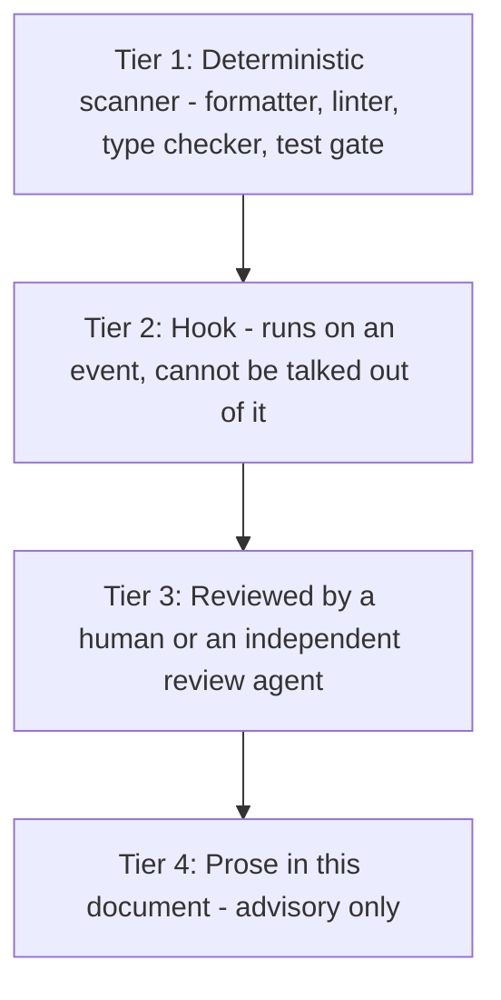

# Coding Standards
<!-- Coding standards, git workflow, code review and error handling for this repo -->
<!-- Adapted from a general team template on 2026-10-08 for a solo Python + Next.js learning project -->
<!-- Last updated: 2026-10-08 -->

Every rule has an **ID** (like `PY-3`) so reviews can cite it, and a **tier** that says how it's enforced. Reviewers (human or AI) cite the ID and explain why it matters.

## The Enforcement Hierarchy

This section comes first because it decides whether the rest of the document is worth anything.

A standard exists at exactly one of four strengths. Know which one each rule is at, and be honest about it:



- **Tier 1, the scanner.** Lint config, formatter, type checker, test suite, build. These are the real standard. They fail the same way for me, tired at 11 pm, as for an agent running unattended. Any rule that can be a scanner rule should be one.
- **Tier 2, the hook.** Things a scanner can't express but that must never be skipped: pre-commit formatting, secret scanning, and the Claude Code hook that blocks AI writes to protected paths (see `AGENTS.md`).
- **Tier 3, review.** Judgement calls: is this the right abstraction, does this name mean what it says, is this retry safe.
- **Tier 4, prose.** Everything left over. It explains the "why" behind tiers 1 to 3, and it's the tier most likely to be skipped.

**The working rule:** if a standard matters, move it down a tier until it executes. If it can't be encoded, write down *why not* and *who checks it*. In this repo "who checks it" is me, plus the independent review session described in section 9.

---

## 1. The single gate

```bash
make verify     # everything below, backend and frontend. If this passes, the mechanical standard is met.
```

| What it runs | Backend (Python) | Frontend (TypeScript) |
|---|---|---|
| Lint | `ruff check` | `pnpm lint` (ESLint) |
| Format check | `ruff format --check` | `pnpm format:check` (Prettier) |
| Types | `mypy --strict` | `pnpm type-check` (`tsc --noEmit`) |
| Tests | `pytest` | `pnpm test` (Vitest, if it exists) |

`make verify` runs in **pre-commit** (tier 2) and in **CI** (tier 1). Secret scanning (`gitleaks`) runs in both too. If `make verify` fails, no explanation in the PR makes up for it.

Never disable a lint rule inline without a comment explaining why. That comment gets reviewed.

---

## 2. General principles (all languages)

| ID | Rule | Tier |
|---|---|---|
| G-1 | **Readability over cleverness.** If a one-liner needs a comment to be understood, write it as clear multi-line code. | 3 |
| G-2 | **Explicit over implicit.** Use domain names (`lead`, `tier`, `fit_signals`, `job`) instead of generic ones (`data`, `item`, `result`, `info`). No abbreviations except universal ones (`id`, `url`, `api`, `llm`). | 3 |
| G-3 | **Single responsibility.** Each function does one thing. Each module owns one concept. If the description needs an "and", split it. | 3 |
| G-4 | **Fail fast and loud.** Validate at the boundary. Raise descriptive, typed errors. Never swallow an exception silently. | 1 (`ruff` BLE, S110) + 3 |
| G-5 | **No dead code.** Delete unused functions, commented-out blocks and obsolete files. Git is the backup. Generated scaffolding (e.g. Alembic env.py, script.py.mako) is exempt. | 1 (`ruff` F, ERA) |
| G-6 | **Small, reviewable diffs.** One issue, one PR. If I can't hold the change in my head, split it. | 3 |
| G-7 | **Comments explain why, not what.** A comment that restates the code is worse than no comment. A comment that records a decision (why this constant, which failure caused this guard) is the most durable documentation there is. | 3 |
| G-8 | **I can explain every line.** If I can't explain a line, it doesn't merge. "The AI suggested it" is not an explanation. | 3 |

```python
# Good: records a decision
# Groq returns 429 once we pass ~8K tokens per minute, so tool results are capped
# well below that to leave room for the prompt and the answer. See ADR-003.
MAX_TOOL_RESULT_TOKENS = 1_500

# Bad: restates the code
# Set max tool result tokens to 1500
MAX_TOOL_RESULT_TOKENS = 1_500
```

---

## 3. Python (backend)

### Tooling (tier 1)

Configured in `backend/pyproject.toml`:

- **ruff**, line length 100. Rule sets: `E`, `F`, `W`, `I` (imports), `N` (naming), `UP` (modern syntax), `B` (bugbear), `BLE` (blind except), `S` (security), `SIM`, `RUF`, `PT` (pytest style), `T20` (no `print`), `ERA` (commented-out code), `ANN` (type annotations), `ASYNC` (blocking calls in async code), `TID` (banned imports, used by LLM-2).
- **mypy** `--strict`, with the Pydantic mypy plugin and the `unused-awaitable` error code enabled.
- **pytest** with `pytest-socket` (`--disable-socket`), so unit tests can't touch the network.

### Rules

| ID | Rule | Tier |
|---|---|---|
| PY-1 | Every function has type hints, including the return type. No `Any` unless a comment explains why. | 1 (mypy, ANN) |
| PY-2 | **Pydantic at every boundary**: HTTP requests, webhook payloads, LLM outputs, tool inputs/outputs, queue job payloads, golden set rows, config (`pydantic-settings`). Inside the boundary, pass typed models, not dicts. | 3 |
| PY-3 | Pydantic models that become LLM schemas use `extra="forbid"`, and optional fields are *required but nullable*, so the generated JSON Schema works in strict mode. | 1 (schema test) + 3 |
| PY-4 | Use discriminated unions for things that come in kinds: event types, agent steps, error categories. Not `if kind == "..."` chains over dicts. | 3 |
| PY-5 | No `print`. Use the structured logger, and always include `run_id` / `job_id` when there is one. | 1 (T20) + 3 |
| PY-6 | No bare `except:` or `except Exception:` that does nothing. Catch the specific error, or re-raise as a typed error with context. | 1 (BLE, S110) |
| PY-7 | Every external call (LLM, HubSpot, web fetch, search) has a timeout and goes through the rate limiter. | 3 |
| PY-8 | Async all the way in request handlers and workers. No blocking calls (`requests`, `time.sleep`) inside async code. | 1 (ruff `ASYNC`) + 3 |
| PY-9 | Tests are named after behaviour: `test_same_event_three_times_creates_one_job`, not `test_ingest_2`. | 3 |
| PY-10 | Unit tests never call a real LLM or API. Use recorded responses in `backend/tests/fixtures/`. Integration tests that hit real services are marked `@pytest.mark.live` and don't run in CI. | 1 (pytest-socket) + 3 |

---

## 4. TypeScript (frontend)

### Tooling (tier 1)

The exact config lives in `frontend/eslint.config.mjs` (written during F0 scaffolding). The rules that matter:

- `typescript-eslint` **strict-type-checked**, plus `react-hooks` recommended, plus `prettier` last.
- `@typescript-eslint/explicit-function-return-type` on exported functions.
- `@typescript-eslint/no-unused-vars` (prefix `_` to ignore on purpose).
- `@typescript-eslint/prefer-nullish-coalescing`.
- `@typescript-eslint/no-floating-promises`: always `await`, or `void` when fire-and-forget is deliberate.
- `no-console` (allow `warn` and `error`).
- `import/order`, alphabetized, groups separated by blank lines.
- `tsconfig.json` with `"strict": true` and `"noUncheckedIndexedAccess": true`.

**Prettier:**
```json
{
  "semi": true,
  "singleQuote": true,
  "tabWidth": 2,
  "trailingComma": "all",
  "printWidth": 100,
  "bracketSpacing": true,
  "arrowParens": "always"
}
```

### Rules

| ID | Rule | Tier |
|---|---|---|
| TS-1 | API types are **generated** from the FastAPI OpenAPI schema, never hand-copied. | 1 (CI checks the generated file is up to date) |
| TS-2 | All logic (API calls, state, validation, approval flow) lives in `src/lib/`. Pages in `src/app/` only lay out components and call `src/lib/`. Components in `src/components/` are presentational. | 3 |
| TS-3 | Every API call handles loading, error and empty states explicitly. No silent failures in the UI. | 3 |
| TS-4 | Lead text (form messages, web content) is untrusted. Never render it with `dangerouslySetInnerHTML`. | 1 (`eslint-plugin-react`: `react/no-danger`) |

---

## 5. Rules for code that talks to LLMs

This is the section a generic template doesn't have, and the one that matters most here.

| ID | Rule | Tier |
|---|---|---|
| LLM-1 | **Prompts live in `prompts/`**, versioned (`v1.md`, `v2.md`) with a `CHANGELOG.md`. Never as string literals in code. | 3 (+ a test that loads every prompt the code references) |
| LLM-2 | **Every LLM call goes through `LLMClient`.** No provider SDK imported outside `llm/`. | 1 (ruff `TID251` banned imports) |
| LLM-3 | **Every LLM output is validated with Pydantic before use.** On failure: one repair retry with the validation error, then a typed error. | 3 |
| LLM-4 | **The LLM never triggers a write.** CRM writes happen in deterministic code after validation. Agents only get tools whose registry entry says `access="read"`. | 1 (registry test) + 3 |
| LLM-5 | **Untrusted input is delimited.** Lead text and fetched pages go inside clearly marked data blocks, never concatenated into instructions. | 3 |
| LLM-6 | **Evidence must be verifiable.** Any quoted evidence is checked literally against its source; unverifiable signals are dropped. | 1 (unit tests) + 3 |
| LLM-7 | **Tool results are truncated to a token budget** before reaching the model. | 3 |
| LLM-8 | **Every run records** model, prompt version, prompt hash, temperature, tokens and latency in the `runs` table. | 3 |
| LLM-9 | **No secrets or real personal data** in prompts, traces, fixtures or logs. | 2 (gitleaks) + 3 |
| LLM-10 | **Tracing fails open.** If LangSmith errors, log it and keep going. A test proves it. | 1 (test) |
| LLM-11 | **Limits live in config, not in code**: steps, calls per tool, timeouts, token budgets. | 3 |

---

## 6. Naming conventions

The scanner enforces what it can (`ruff` N rules, ESLint). This table is the reference.

| Context | Python | TypeScript |
|---|---|---|
| Files / modules | `snake_case.py` | kebab-case: `lead-detail.tsx` |
| Test files | `test_<module>.py` | `<name>.test.ts` |
| Classes / components / types | `PascalCase` | `PascalCase` |
| Functions, variables | `snake_case` | `camelCase` |
| Constants | `UPPER_SNAKE_CASE` | `UPPER_SNAKE_CASE` |
| Database tables | `snake_case`, plural: `jobs`, `hubspot_writes` | — |
| Database columns | `snake_case`: `created_at` | — |
| API endpoints | kebab-case: `/api/v1/approval-queue` | — |
| Environment variables | `UPPER_SNAKE_CASE`: `GROQ_API_KEY` | same |
| HubSpot custom properties | `rw_` prefix: `rw_tier` | — |
| Git branches | `feature/12-signed-webhook-ingest` | same |

---

## 7. Error handling

### ERR-1: Use the error taxonomy (tier 3)

Every error belongs to one of the categories in PRD section 10.3, and the category decides what happens:

| Category | Behaviour |
|---|---|
| Retryable (rate limited, upstream unavailable, timeout) | Backoff with jitter, then DLQ |
| Invalid LLM output | One repair retry, then DLQ |
| Not retryable (bad request, invalid signature, invalid payload) | Reject or DLQ immediately |
| Tool error inside the agent | Returned to the agent as an observation, not raised |

Errors are **typed classes**, never strings or generic `Exception`. Retry logic decides based on the error's category, not by parsing messages.

### ERR-2: Map errors to HTTP responses in exactly one place (tier 3)

One FastAPI exception handler turns domain errors into responses. Unknown errors are logged with full detail and returned as a generic 500. Handlers don't build error responses themselves.

### ERR-3: A failed lead is still a lead (tier 3)

Whenever a job ends in the DLQ, the contact's `rw_review_status` becomes `needs_manual_review`. No code path may lose a lead silently.

### ERR-4: Async errors (tier 1)

Always `await`. No floating promises in TypeScript (`no-floating-promises`). In Python, no dangling tasks (ruff `RUF006`) and no ignored awaitables (mypy `unused-awaitable`).

---

## 8. Git workflow

### GIT-1: Branches

One branch per issue, named after it:
```bash
feature/12-signed-webhook-ingest
fix/31-lease-not-released-on-crash
docs/40-adr-workflow-vs-agent
test/22-force-agent-infinite-loop
chore/5-ci-skeleton
```

### GIT-2: Commits

Conventional commits with a scope. **I make every commit**; an AI may suggest the message.
```bash
feat(ingest): validate HMAC signature with a 5-minute timestamp window
fix(queue): release the lease when a worker crashes mid-job
refactor(agent): move step limits into config
test(scoring): cover evidence quotes missing from the source
docs(adr): record workflow vs. agent results
chore(ci): run evals on recorded responses
```

### GIT-3: Pull requests

1. Open the PR with a title that follows the commit convention, and `Closes #N`.
2. **Self-review first.** Read the whole diff before asking anyone or anything to review it.
3. `make verify` passes locally and in CI. No exceptions.
4. Run the independent review (section 9). Answer **every** finding, even if only "Done" or "Won't fix because…".
5. **Squash merge.** The PR title becomes the commit message on `main`.

---

## 9. Code review

### Self-review checklist

- [ ] Does the code do what the issue's "Done when" says?
- [ ] Are there tests, including error paths and edge cases?
- [ ] Is every error typed, and is it logged with enough context (`run_id`, `job_id`)?
- [ ] Security: signatures, input validation, untrusted text, secrets?
- [ ] Consistent with existing patterns in the codebase?
- [ ] Any new dependency justified? Did I check alternatives?
- [ ] Any dead code, commented-out code, or TODO without an issue?
- [ ] Is a migration reversible, and does it handle existing data?
- [ ] **Can I explain every line?**

### The independent review agent

Automated review is valuable, and it fails in a specific way when set up carelessly:

- **Never let one agent write, review, fix and approve the same change.** A reviewer that produced the plan inherits its blind spots. In this repo the AI doesn't write the core code, but the session that gave me hints is still not neutral. **Review in a fresh session.**
- **The reviewer gets the diff, the issue and these standards.** Not my plan or the hints it gave me.
- **Read-only.** It reports findings; it doesn't edit. A reviewer that can silently fix can silently hide.
- **Findings are recorded** as PR comments. A finding that only existed in a terminal scrollback is not a control.
- **Scanners run first.** If `make verify` fails, stop there.
- **Narrow reviewers beat one broad one.** Standards + spec review on every PR (`code-review-matt-pocock`); a separate security review for changes to ingest, webhooks, the agent or the CRM client.
- **Findings are advice to me, not approval.** I decide, and if I override a finding, I say why in the comment.

### Comment prefixes

```text
blocker:    must be fixed before merge
concern:    likely problem, should be addressed before merge
suggestion: worth considering, non-blocking
question:   asking for clarification
nit:        minor style point, non-blocking
praise:     something done well (do this often)
```

Every finding cites a rule ID from this document when one applies.

---

## 10. Database

| ID | Rule | Tier |
|---|---|---|
| DB-1 | Parameterized queries only. Never build SQL with string formatting. | 1 (ruff `S608`) |
| DB-2 | Never `SELECT *`. List the columns you need. | 3 |
| DB-3 | Anything that could return an unbounded result has a `LIMIT`. List endpoints paginate (default 20, max 100). | 3 |
| DB-4 | Index the columns used in `WHERE`, `JOIN` and `ORDER BY`, especially the queue's polling query. Check it with `EXPLAIN`. | 3 |
| DB-5 | Uniqueness that protects correctness (idempotency keys, `hubspot_writes.idempotency_key`, webhook `eventId`) is a **unique constraint in the database**, not only a check in code. | 3 |
| DB-6 | Every schema change is a migration. Migrations are reversible. | 3 |

---

## 11. Security checklist

Each box maps to a tier 1 or tier 2 control where possible. Where it doesn't, the owner is me, at self-review.

- [ ] Webhook signatures verified, with a timestamp window to block replays (tests in `backend/tests/`)
- [ ] All input validated with Pydantic at the API boundary (PY-2)
- [ ] Parameterized queries only (DB-1, ruff `S608`)
- [ ] Untrusted text never rendered as HTML (TS-4)
- [ ] Untrusted text never mixed into prompt instructions (LLM-5)
- [ ] Agents only receive read tools (LLM-4, registry test)
- [ ] Secrets only in `.env`, never committed, never logged or traced (gitleaks in pre-commit and CI)
- [ ] HubSpot private app uses minimum scopes (ADR-007)
- [ ] Dependencies audited in CI (`pip-audit`, `pnpm audit`)
- [ ] Public ingest endpoint is rate limited
- [ ] AI write access to core paths is blocked by the Claude Code hook (`AGENTS.md`)

---

## 12. Debugging

These commands are planned and will exist once the related phase is built.

```bash
LOG_LEVEL=debug make dev                        # verbose structured logs
uv run pytest backend/tests/test_queue.py -x    # one test file, stop at first failure
make run-show RUN_ID=...                        # print everything the runs table knows about one run
make dlq-list                                   # jobs in the dead-letter queue
make dlq-retry JOB_ID=...                       # reprocess one job
make eval CASE=lead_017 SPLIT=dev               # re-run one golden set case
```

**When something breaks that review didn't catch,** work backwards through the enforcement hierarchy. Which tier should have caught it? If the answer is "tier 4, the prose said not to", you've found the next scanner rule or test. Every bug is an argument for moving one standard down a tier.
