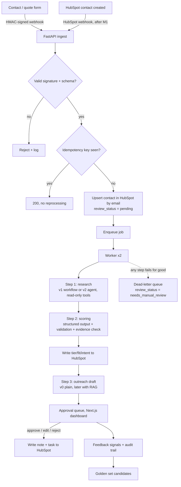

# PRD: Inbound Lead Qualification Agent

> Version 1.0, 2026-10-08. Built from `BRIEF.md` through a grill-me session.
> `BRIEF.md` stays untouched as the record of where this started. When this PRD and the brief disagree, this PRD wins.

---

## 1. What this is, in one paragraph

A learning and portfolio project. A fictional company, **Rackwise**, sells industrial storage (racks, shelving, mezzanines) in the US and Mexico. Leads arrive through web forms. Within five minutes, the system should research each lead, qualify it, write a first outreach draft, and put everything in front of a sales rep, who approves, edits or rejects it. Results land in HubSpot. The point is not the product. The point is that I can build it, explain every part of it, and defend the tradeoffs in an interview for **AI Engineer / Forward Deployed Engineer** roles.

---

## 2. Goals

### 2.1 What I want to be able to defend in an interview (in priority order)

| # | Core skill | Evidence |
|---|---|---|
| 1 | **Scoring with structured outputs + evals** (Pydantic, JSON Schema, golden set, offline evals) | Eval reports per prompt/model version, results on a held-out set |
| 2 | **A hand-written agent loop** with a tool registry and hard limits, plus the workflow vs. agent experiment | Agent code with no framework, ADR with comparative metrics |
| 3 | **Event-driven ingestion** with webhooks, idempotency, a home-made queue, and a dead-letter queue | "Same event sent 3 times → 1 contact, 1 job" demo, tests |
| 4 | **Human-in-the-loop**: approval dashboard, HubSpot writeback, audit trail | Working dashboard, `runs` table |

Pydantic is a thread through all four, not a separate item. I want to learn it well.

### 2.2 Secondary (minimal version, about a week each)

- **MCP**: expose the read-only tools as an MCP server.
- **RAG**: retrieval over a product catalog to personalize outreach.
- **Observability**: structured logs, plus LangSmith traces linked from the audit trail.

### 2.3 Cut or postponed

- **LangGraph migration**: cut. At most an optional one-day spike after F7, with a short memo on what it would give and take away.
- Everything in section 13.

---

## 3. Definition of done (the whole project)

The project is done when **all** of these are true:

1. Replaying the full golden set live meets **p95 under 5 minutes** from form submission to draft in the approval queue, with leads arriving at **1 lead per minute or slower**.
2. The idempotency demo works: the same event sent 3 times produces 1 HubSpot contact and 1 job.
3. The eval report covers **at least 2 prompt versions and 2 models**, the **workflow vs. agent** comparison and the **temperature** experiment, with results on the **held-out set**.
4. Every prompt-injection case in the golden set has **zero possible write actions**, and its effect on the tier is measured.
5. Docs exist: ~7+ ADRs, `docs/discovery.md`, `docs/tradeoffs-memo.md`, a README with diagrams, `LEARNING_LOG.md`, and a 3–5 minute demo video.
6. **Learning check:** I can rewrite the agent loop and the queue consumer from scratch, without help, in under an hour each.

### Milestones

| Milestone | Target | Covers |
|---|---|---|
| **Milestone 1: thin end-to-end demo** | End of week 4 (~120 h) | F0 → F3 |
| **Milestone 2: project done** | End of week 9 | F4 → F7 |

Capacity: about 30 hours a week. If I fall behind, cut F6 (RAG) or F5 (MCP). The core never gets cut.

---

## 4. Constraints

1. **US$0.** No service that can charge without my explicit authorization. Never add a card to a free tier. Every external dependency is verified and recorded in a dated ADR.
2. **Synthetic data only.** No real people, no real private companies. In live demo mode, real public company domains may be used for web research, without personal data.
3. **I write the core code.** The rules for working with AI are in [`AGENTS.md`](AGENTS.md) and enforced by a Claude Code hook. All commits are mine.
4. **English** for code, docs, ADRs, issues and the learning log, written in plain, human language.

---

## 5. The business scenario

**Rackwise** is a fictional B2B distributor of industrial storage systems. It sells to warehouses, manufacturers, 3PLs and retailers with their own warehouse, in the US and Mexico. All leads are in English.

**The stakeholder's problem:**
> "Leads come in through the contact form and the quote request form. Reps take hours to respond, half the leads are spam, students or competitors, and when reps finally call they know nothing about the company. I want a rep to have a researched, qualified lead with a personalized first message ready to review in under 5 minutes."

**Lead sources:**
1. **Contact form** (Next.js landing page).
2. **Quote request form**: more fields, such as dimensions, quantities and target date.
3. **HubSpot contact created** (via HubSpot webhook): a second source, added after Milestone 1 to demonstrate cross-source deduplication.

The Next.js form handler plays the role of a **third-party form provider**. It signs the payload with HMAC and sends it as a webhook to the FastAPI backend. A CLI replay script sends the same signed events, for evals, demos and the idempotency test.

---

## 6. Qualification model

Inbound lead scoring tools (HubSpot, Marketo, Pardot) score leads on two separate axes: how well the company **fits**, and how strong the buying **intent** is. Sales reps typically use **BANT** (Budget, Authority, Need, Timeline). This project combines them: a **fit × intent matrix**, where intent is built from BANT-style signals.

### 6.1 Step 1: disqualification gates

Checked first. If any applies, the lead is `disqualified` and the other steps don't matter.

| Reason | Example |
|---|---|
| `spam` | Gibberish, SEO offers, crypto |
| `competitor` | Another storage distributor fishing for prices |
| `student` | "I'm writing a thesis on warehouse design" |
| `job_seeker` | "Are you hiring?" |
| `out_of_region` | Outside the US and Mexico |

**Missing information is not a disqualification.** A lead with too little information becomes tier C with a filled-in `missing_info` list. Throwing away a real buyer because they wrote a short message is the expensive mistake.

### 6.2 Step 2: fit (does this company look like our customer?)

| Level | Rule |
|---|---|
| high | Operates a warehouse **and** has 20–1,000 employees **and** is in a target industry (3PL, manufacturing, distribution, retail with a warehouse) |
| medium | One of the three is missing |
| low | Two or more are missing |

### 6.3 Step 3: intent (are they actually trying to buy?)

| Level | Rule |
|---|---|
| high | A concrete project **plus** a timeline or a budget, **or** a quote request with quantities or dimensions |
| medium | A project is mentioned, but no timeline or budget |
| low | Generic inquiry |

### 6.4 Step 4: tier

|  | intent high | intent medium | intent low |
|---|---|---|---|
| **fit high** | **A** | B | C |
| **fit medium** | B | C | C |
| **fit low** | C | C | C |

**The tier is computed by code from fit and intent, not by the LLM.** The LLM judges the gates, fit and intent, with evidence. The matrix is deterministic, so the tier is always consistent with the two axes. There is no 0–100 score: LLMs calibrate numbers poorly, and the matrix already says what the rep needs.

### 6.5 Scoring output (Pydantic model, first written by hand as JSON Schema)

| Field | Type | Notes |
|---|---|---|
| `disqualification_reason` | enum or null | See 6.1 |
| `fit` | enum: high, medium, low | |
| `intent` | enum: high, medium, low | |
| `fit_signals` | list of `{signal, evidence, source}` | `evidence` is a literal quote, `source` is a form field or URL |
| `intent_signals` | list of `{signal, evidence, source}` | Timeline, budget, project, quantities |
| `missing_info` | list of strings | What the rep should ask |
| `summary_for_rep` | short string | English |
| `confidence` | enum: low, medium, high | Measured for calibration in the evals |

`tier` is added by code after validation.

**Evidence rule:** every claim needs a literal quote that can be found in its source. A deterministic check verifies this. If the quote is not in the source, the signal is dropped.

The full labeling criteria, with worked examples, live in `evals/LABELING_CRITERIA.md` (written in F0, refined in F2).

---

## 7. Architecture



### Design principles

1. **The pipeline is a deterministic workflow.** Only the research step is an agent, with bounded autonomy.
2. **The LLM never writes to the CRM.** Deterministic code writes, after validation.
3. **No lead is ever lost.** The HubSpot contact exists before any AI runs. If the AI fails, the rep still sees the lead, marked `needs_manual_review`.
4. **Research and scoring are separate LLM calls.** Groq can't combine tool calling and structured output in one call, and keeping them separate makes each step easier to test and evaluate.
5. **Two run modes:**
   - `eval`: fictional web, pinned model, response cache, fully reproducible.
   - `live`: Tavily plus real public domains, with fallback to Gemini when Groq returns 429. The model actually used is recorded per run.

---

## 8. Stack

Facts verified on 2026-10-08. Re-check in F0 and record in ADR-001.

| Component | Choice | Why / notes |
|---|---|---|
| Backend | Python 3.12, FastAPI, managed with `uv` | All business logic lives here |
| Validation | **Pydantic** is the source of truth; JSON Schema is generated with `model_json_schema()` | The first schema (scoring) is written by hand, then a test checks Pydantic produces an equivalent one |
| Config | `pydantic-settings` | |
| Database | Postgres (Docker) + pgvector | |
| Queue | Home-made, a Postgres table with `SELECT … FOR UPDATE SKIP LOCKED` | Teaches queue fundamentals. ADR-002 |
| Frontend | Next.js + TypeScript (strict), `pnpm` | UI only, calls FastAPI. TS types generated from FastAPI's OpenAPI |
| Main LLM | **Groq** (`qwen/qwen3.8-27b` or `openai/gpt-oss-120b`, picked in F0 with 5 test leads) | No card, no training on data, zero data retention available. ADR-003 |
| Fallback LLM | Gemini Flash-Lite, **live mode only** | Free-tier data is used by Google for training, which is acceptable for synthetic data |
| Local LLM | Ollama | Prompt iteration without spending quota, second model in eval reports |
| LLM abstraction | My own `LLMClient` interface | Switch providers without touching logic |
| Agent framework | **None.** Hand-written loop | |
| Tracing | LangSmith Developer, **no card ever** (hard-stops at 5k traces/month without one) | Fail-open: if LangSmith errors, the pipeline keeps going |
| Audit trail | Own `runs` table | Source of truth. LangSmith is an extra view |
| CRM | HubSpot Free, standard account, **legacy private app** (not a "project" app) | Private apps built as projects don't support webhooks |
| Tunnel | `cloudflared` quick tunnel | URL changes on every restart, so the HubSpot webhook URL must be re-pasted. Polling or manual replay as fallback |
| Web search (live) | Tavily (1,000 credits/month, no card, hard stop) | Serper as fallback |
| Web (eval) | `fake_web/`: static sites of fictional companies + fake search index | See 11.2 |
| Embeddings | Local, sentence-transformers | |
| MCP | Python MCP SDK | |
| Tests | pytest (+ `pytest-socket` to forbid network in unit tests), Vitest if time allows | |
| CI | GitHub Actions on a public repo | Runs with recorded LLM responses, no live calls |
| Deploy | `docker-compose` + demo video | No public deploy: an open form would burn the Groq quota and needs anti-abuse work that's out of scope |

---

## 9. Quotas, budgets and the SLA

The free tiers shape the design, so the limits are part of the spec.

| Limit (verify in F0 at console.groq.com/settings/limits) | Approx. value |
|---|---|
| Groq requests per minute / per day (per model) | 30 / 1,000 |
| Groq tokens per minute (per model) | ~8,000 |
| Groq tokens per day (per model) | ~200,000 |
| HubSpot API | 100 requests / 10 s per app |
| LangSmith | 5,000 traces / month |
| Tavily | 1,000 credits / month |

**Decisions that follow:**
- **Token budget per run: 6,000 tokens or less**, across research, scoring and outreach. Exceeding it aborts the run cleanly.
- **Tool results are truncated or extracted** to about 1,500 tokens before reaching the LLM.
- **Daily token budget with a circuit breaker**: when it's exceeded, the queue pauses, it doesn't fail.
- **Rate limiter:** my own token bucket per provider (Groq requests and tokens, HubSpot requests), with exponential backoff and jitter.
- **Response cache** keyed by hash(prompt version, model, input, temperature).
- **Prompts are iterated with Ollama and the dev split.** Groq is used for "official" runs only.
- **SLA:** p95 under 5 minutes **at 1 lead per minute or slower**. Higher arrival rates are out of scope, and that tradeoff goes in the memo.

---

## 10. Reliability and safety

### 10.1 Idempotency

| Where | Key |
|---|---|
| Form submissions | `hash(source + email + submission_id)` |
| HubSpot webhooks | `eventId` |
| HubSpot contact | Upsert by email |
| **Every HubSpot write** (note, task, property update) | `hash(job_id + step_name)`, stored in a `hubspot_writes` table (`idempotency_key → hubspot_object_id`). Checked before each write |

HubSpot has no idempotency keys for notes and tasks, so without the `hubspot_writes` table a retried job would create a second note.

### 10.2 Queue

- A `jobs` table with status, attempts, `next_run_at`, and a **lease** (`locked_until`), so a job held by a dead worker gets picked up again.
- **Two workers.** The real throughput limit is the LLM quota, not the CPU.
- **Step checkpoints:** each step stores its result, and a retry resumes from the last completed step.
- At-least-once delivery, idempotent effects.
- Dead-letter queue plus a script to inspect and reprocess.

### 10.3 Error taxonomy

| Kind | Examples | What happens |
|---|---|---|
| Retryable | 429, 5xx, timeouts | Backoff with jitter, max N attempts, then DLQ |
| Invalid LLM output | Fails Pydantic validation | **One** repair retry, sending the validation error back to the model, then DLQ |
| Not retryable | 400, invalid schema, invalid signature | Straight to DLQ (or reject at ingest) |
| Tool errors inside the agent | Page 404, search timeout | Returned to the agent **as an observation**, not raised |

Whenever a job ends in the DLQ, the contact is marked `rw_review_status = needs_manual_review`.

### 10.4 The research agent

| Tool | Access | Backends |
|---|---|---|
| `search_web(query)` | read | fake index (eval) / Tavily (live) |
| `fetch_page(url)` | read | fake_web (eval) / HTTP (live). Returns extracted text, truncated to ~1,500 tokens |
| `crm_find_company(domain)` | read | HubSpot |
| `crm_find_contact(email)` | read | HubSpot |
| `finish(findings)` | — | Ends the loop with structured findings (Pydantic) |

**Limits:**
- Max **6 steps** and max **2 calls per tool**.
- **10 s** timeout per tool and **90 s** per run.
- The token budget from section 9.

**Hitting a limit is not a failure.** The agent returns what it has, marked `research_incomplete`, and scoring continues.

**The tool registry** holds each tool's metadata: name, description, input/output schema, read or write access, whether it needs approval, timeout, token budget, and available backends. The research agent can only receive read tools.

### 10.5 Prompt injection

Three layers:
1. **Structural:** the agent only has read tools, and only deterministic code writes.
2. **Delimiting:** lead input and fetched pages are clearly marked as untrusted data in prompts.
3. **Evidence verification:** every quoted piece of evidence must literally appear in its source. This catches both hallucinations and most "rate me tier A" injections, and gives a measurable number.

Injection cases in the golden set cover both **direct** injection (in the form message) and **indirect** injection (hidden in a fictional company's web page).

### 10.6 Permissions and secrets

- HubSpot private app with **minimum scopes**: contacts read/write, notes and tasks write, companies read. Documented in a permissions matrix (ADR-007).
- No email or message is ever sent.
- `.env` stays out of the repo. Tokens never appear in logs or traces. Secret scanning runs in pre-commit.
- Lead text is rendered escaped in the dashboard (it's untrusted input).

### 10.7 Audit trail

The `runs` table stores, for each run:
- input, mode, model actually used, prompt version and prompt content hash
- tools called, with arguments and truncated results
- outputs, tokens, latency
- LangSmith trace ID
- approver, decision, edits and rejection reason

---

## 11. Evaluation plan

### 11.1 The golden set (an exam with an answer key)

**How it's made:**
1. **I write ~60 scenario cards by hand.** Each card has the company profile, what the form says, the expected label (gates, fit, intent, tier), the "trap" in the case, and what its fictional web page should contain.
2. **Claude turns each card into realistic text:** the form submission and the fictional company's web page. Claude is a different model family from the one being evaluated, which reduces the "model grades itself" bias.
3. **A few days later, I re-label the final text without looking at the card.** If my answer changed, the case or the criteria are ambiguous, and I fix the criteria doc.

**Mix of cases:**

| Kind | Share |
|---|---|
| Disqualified (all 5 reasons) | ~30% |
| **Borderline cases** (A/B and B/C) | ~30% |
| Prompt injection (direct + indirect) | ~10% |
| Clean, clear cases | the rest |

**Split: 40 dev / 20 held-out.** I iterate prompts on dev only. Held-out runs only at milestones, and I don't look at its individual failures while iterating. Otherwise I'd end up tuning prompts to the exam.

**Feedback loop:** every rejection or big edit in the dashboard becomes a golden set *candidate*. It gets a card, gets labeled by me, and goes into dev, never directly into held-out.

### 11.2 Fictional web for evals

`fake_web/` holds static sites for the fictional companies plus a fake search index, served locally. Eval mode uses only this. Why:
- Labels don't change when a real website changes, so evals are reproducible.
- No Tavily credits are spent on eval runs.
- Indirect injection can be planted in pages on purpose.

Same tool interface, swappable backends.

### 11.3 Offline metrics

**Deterministic checks:** valid schema, enums in range, evidence present **and found in source**, summary in English, no invented personal data.

**Classification:**
- Confusion matrix (tier and each axis separately).
- **Two headline numbers:** how many real A leads were caught (A recall), and how many good leads were wrongly disqualified.
- **Penalty score**, because not every mistake costs the same:

| Mistake | Penalty |
|---|---|
| A labeled as disqualified | 10 |
| A labeled as C | 5 |
| B labeled as disqualified | 5 |
| Disqualified labeled as A | 3 |
| Any other off-by-one tier mistake | 1 |

  Lower total wins. **No targets before the baseline:** F2 measures the starting point, then the targets go in ADR-006.
- **Confidence calibration:** when the model says "high", is it right more often?
- Valid-output rate, tokens per run, latency.

**Outreach quality (F6):** LLM-as-judge with an explicit rubric, **calibrated against my own grades on ~20 samples**. Its agreement with me is reported.

**Retrieval (F6):** ~25 hand-written queries with their relevant documents. Recall@5 and MRR.

**Regression:** every prompt or model change runs the dev split. Results are stored per version in `evals/reports/`.

**CI:** deterministic checks plus evals on **recorded responses**, with no live LLM calls.

### 11.4 Experiments

| Experiment | Setup | Output |
|---|---|---|
| Workflow vs. agent | v1 fixed research sequence vs. v2 agent, on the dev split | Quality, tokens, latency, variability, failure modes. ADR |
| Temperature | Scoring at 0 vs. 0.7, **15 leads × 5 runs each** | Chart of consistency + recommendation |
| Models | Groq model vs. Ollama (Gemini optional) | Rows in the eval report |
| RAG (F6) | Chunk size, **or** vector vs. hybrid with BM25 | Retrieval metrics |

### 11.5 Online evals

**Implemented:**
- Approval without edits, edit distance, rejection reasons, time to approval.
- The "rejection → golden set candidate → re-label" flow.
- A **blind review toggle**: hide the model's tier until I've formed my own opinion.

**Stated honestly:** with one reviewer (me) who also designs the prompts, online metrics demonstrate the **mechanics**, not real results. Reviewing in batches with the blind toggle reduces, but doesn't remove, that bias.

---

## 12. HubSpot integration

| Decision | Choice |
|---|---|
| Account | Standard HubSpot Free (a developer test account expires after 90 days without use) |
| App | Legacy private app, standalone, minimum scopes |
| Custom properties (Free allows 10 total) | `rw_tier`, `rw_fit`, `rw_intent`, `rw_disqualification_reason`, `rw_review_status` (pending, approved, rejected, needs_manual_review), `rw_run_id` |
| Everything else | In a **note**: summary, signals with evidence, missing info |
| When to write | **Right after scoring:** the qualification properties, with `rw_review_status = pending`. **After approval only:** the outreach note and a task for the rep |
| HubSpot as a lead source | Webhook on contact creation, added after Milestone 1. v3 signature validation, `eventId` dedupe |

---

## 13. Out of scope

- Sending real emails or messages.
- Scraping LinkedIn or any site whose terms forbid it.
- Real personal data.
- Multi-tenancy, real authentication, user roles.
- Fine-tuning.
- 24/7 availability, public deploy.
- **Future ideas** (not in this project): phone-call leads with local transcription (bridge to project 3), learning from deal outcomes (bridge to project 2), full LangGraph migration.

---

## 14. Phases

The **AI help** column follows [`AGENTS.md`](AGENTS.md). "Hints" means the AI gives tiered hints only and I write the code. "Allowed" means scaffolding, UI, configs or synthetic data.

### F0: Spikes and discovery (~15 h, 2–3 days)

**Goal:** check every assumption before building anything.

| Deliverable | AI help |
|---|---|
| Groq limits checked in console; pick the model with 5 test leads | Hints |
| HubSpot legacy private app with minimum scopes; webhook received through `cloudflared`; the 6 custom properties created | Allowed (setup steps) |
| LangSmith connected (**no card**); Tavily key | Allowed |
| Monorepo scaffolding, `docker-compose`, `make verify`, pre-commit, CI skeleton | Allowed |
| `docs/discovery.md`: the stakeholder's requirements turned into a technical spec | I write; AI reviews |
| `evals/LABELING_CRITERIA.md`, first version | I write |
| ADR-001 stack and free tiers, ADR-002 queue, ADR-003 LLM and quotas, ADR-004 qualification model, ADR-005 fictional web | AI drafts from my notes, I review |

**Done when:** every row above exists, and every verified limit is in ADR-001 with its date.

### F1: Ingestion without AI (~30 h)

**Goal:** pure event-driven automation.

| Deliverable | AI help |
|---|---|
| Next.js contact and quote forms (UI) | Allowed |
| Form handler that signs with HMAC and forwards (stand-in for a form provider), and its validation logic | Hints |
| Ingest endpoint: signature check (with timestamp window), Pydantic validation, idempotency key | Hints |
| HubSpot upsert by email with `rw_review_status = pending` | Hints |
| `jobs` table with SKIP LOCKED, lease, retries, DLQ, reprocess script | Hints |
| Signed event replay CLI | Hints |
| Tests for each error type | Hints |

**Done when:** the same event sent 3 times produces 1 contact and 1 job. A worker killed mid-job has its job picked up after the lease expires. Invalid signatures and payloads are rejected and logged. `make verify` passes.

### F2: Golden set, eval harness and scoring (~40 h)

**Goal:** a first LLM call, measured properly from day one.

| Deliverable | AI help |
|---|---|
| ~60 scenario cards | I write |
| Rendered forms and fictional web pages from the cards (`evals/rendered/`, `fake_web/`) | Allowed |
| Blind re-labeling pass, criteria doc updated | I do it |
| `golden_set.jsonl` assembled, 40/20 split | Hints |
| `LLMClient` (Groq + Ollama), rate limiter, token budget, response cache | Hints |
| v1 workflow research (fetch site → extract → summarize) | Hints |
| Scoring: JSON Schema by hand → Pydantic model → equivalence test → validation with one repair retry → evidence check → tier matrix | Hints |
| Eval runner, metrics, penalty score, reports per version | Hints |
| `prompts/scoring/v1.md` + CHANGELOG; prompt version and hash in `runs` | I write |
| Structured logs with `run_id`; LangSmith tracing, fail-open | Hints |
| Temperature experiment | Hints |
| ADR-006 eval strategy, with targets set from the baseline | AI drafts, I review |

**Done when:** a baseline report exists on the dev split, ADR-006 has targets, the temperature experiment is written up, and CI runs the evals on recorded responses.

### F3: Close the loop, end-to-end (~35 h) → Milestone 1

**Goal:** a thin but complete demo.

| Deliverable | AI help |
|---|---|
| Outreach v0 (plain prompt, no RAG) | Hints (prompt is mine) |
| HubSpot writes with `hubspot_writes` idempotency and step checkpoints | Hints |
| Dashboard layout and components | Allowed |
| Dashboard logic: typed API client, data fetching, approve/edit/reject flow, optimistic updates, error states, blind toggle | Hints |
| Approval → note + task in HubSpot | Hints |
| Online eval signals stored | Hints |
| ADR-007 permissions matrix | AI drafts, I review |

**Done when:** a form submission ends with a qualified contact in HubSpot and a draft in the dashboard. Approving it creates exactly one note and one task, even if the job is retried. **Milestone 1 demo recorded** (rough, for myself).

### F4: The agent by hand (~45 h)

**Goal:** a tool-calling loop with no framework.

| Deliverable | AI help |
|---|---|
| Tool registry with metadata and tests | Hints |
| The 4 read tools + `finish`, with fake and live backends | Hints |
| Agent loop with step, per-tool and token limits, timeouts, `research_incomplete` | Hints |
| Tests that force infinite loops, tool failures and budget overruns | Hints |
| Workflow vs. agent experiment + ADR | AI drafts ADR, I review |
| Gemini fallback in live mode | Hints |
| HubSpot webhook as a second source (cross-source dedupe) | Hints |

**Done when:** the agent runs on the dev split within its limits, the comparison ADR is written with numbers, and the "learning check" for the agent loop is passed once.

### F5: MCP (~20 h)

| Deliverable | AI help |
|---|---|
| MCP server exposing the read tools from the registry + 1 resource (the ICP doc or the catalog) | Hints |
| Server enforces registry permission metadata (read-only) | Hints |
| Tested with MCP Inspector and Claude Code / Claude Desktop as an external client | Allowed (setup) |
| Agent flag to consume tools over MCP instead of in-process | Hints |

**Done when:** an external MCP client can query the CRM and catalog tools, and no write tool is reachable.

### F6: RAG and outreach quality (~30 h)

| Deliverable | AI help |
|---|---|
| Synthetic corpus: ~40 products with specs, ~15 case studies by industry, FAQs (~150–300 chunks) | Allowed |
| Chunking, local embeddings, pgvector retrieval | Hints |
| ~25 retrieval queries with relevant docs, recall@5 and MRR, one experiment | Hints (queries are mine) |
| Outreach v1 with retrieved references | Hints |
| LLM-as-judge rubric, calibrated against my grades on ~20 samples | Hints |
| ADR: why RAG here (token budget, not catalog size) | AI drafts, I review |

**Done when:** outreach drafts cite catalog items, and retrieval and judge metrics are in the report.

### F7: Hardening and storytelling (~40 h) → Milestone 2

| Deliverable | AI help |
|---|---|
| Full injection suite run; results in the report | Hints |
| Live replay of the golden set; p95 measured | Hints |
| Held-out evaluation | Hints |
| Online metrics panel in the dashboard | UI allowed, logic hints |
| Dependency audit in CI | Allowed |
| README with diagrams, `docs/tradeoffs-memo.md` for a non-technical reader | I write; AI reviews |
| 3–5 min demo video | I do it |
| Learning check: agent loop and queue consumer rewritten from scratch in under 1 h each | I do it |

**Done when:** section 3 is fully true.

---

## 15. Repository layout

```
backend/
  src/rackwise/
    main.py, config.py, db.py      → app wiring (scaffolding)
    domain/                         → Pydantic models, error types
    ingest/                         → webhook endpoints, signatures, idempotency
    queue/                          → jobs, leases, retries, DLQ, workers
    pipeline/                       → step orchestration, checkpoints
    agent/                          → agent loop, limits
    tools/                          → tool registry and tools
    llm/                            → LLMClient, providers, cache
    limits/                         → rate limiter, token budgets, circuit breaker
    crm/                            → HubSpot client, hubspot_writes
    scoring/                        → scoring step, evidence check, tier matrix
    rag/                            → chunking, embeddings, retrieval
    mcp_server/                     → MCP adapter over the registry
  migrations/
  tests/
    fixtures/                       → recorded responses, sample payloads
frontend/
  src/app/                          → pages and layouts
  src/components/                   → presentational components
  src/lib/                          → API client, types, validation, approval logic
evals/
  LABELING_CRITERIA.md
  cards/                            → scenario cards (mine)
  rendered/                         → text generated from cards
  golden_set.jsonl
  runner/, metrics/                 → eval code
  reports/                          → results per version
prompts/
  scoring/, research/, outreach/    → v1.md, v2.md…, CHANGELOG.md
fake_web/                           → fictional company sites + fake search index
docs/
  discovery.md, tradeoffs-memo.md
  adr/
```

Convention for the frontend: pages in `src/app/` only lay out components and call functions from `src/lib/`. All logic lives in `src/lib/`.

---

## 16. Way of working

The detailed rules are in [`AGENTS.md`](AGENTS.md) and [`CODING_STANDARDS.md`](CODING_STANDARDS.md). Summary:

- **One branch and one PR per issue.** Squash merge. CI must pass.
- **Every commit is mine.** The AI may suggest messages or how to group files.
- **Review:** `make verify` first. Then a **separate** AI session reviews against the standards and the issue (`code-review-matt-pocock`), plus `/security-review` for ingest, webhooks or agent changes. Findings are posted as PR comments, and I answer each one.
- **Issues:** the AI drafts a phase's issues on request ("create the issues for F1") using `.github/ISSUE_TEMPLATE/task.md`. I approve the drafts before they're created with `gh`. Each phase is a milestone.
- **ADRs** are written when the decision is made, not afterwards. The AI may draft them from my notes. The reasoning is mine.
- **Learning log:** every hint I ask for goes in `LEARNING_LOG.md`.

---

## 17. ADR backlog

| ADR | Topic | Phase |
|---|---|---|
| 001 | Stack and free tiers (dated) | F0 |
| 002 | Home-made Postgres queue vs. Redis | F0 |
| 003 | Groq as main LLM, quotas and token budgets | F0 |
| 004 | Qualification model: gates + fit × intent | F0 |
| 005 | Fictional web for evals, live web for demos | F0 |
| 006 | Eval strategy, penalty score and targets | F2 |
| 007 | Permissions matrix | F3 |
| 008 | Workflow vs. agent for research (with results) | F4 |
| 009 | MCP scope | F5 |
| 010 | RAG justification and design | F6 |
| 011 | Observability: own audit trail + LangSmith fail-open | F2 |

---

## 18. Risks

| Risk | Mitigation |
|---|---|
| Free tiers change mid-project | `LLMClient` abstraction, Ollama, dated ADRs, cached responses |
| Groq daily token quota limits eval runs | 6K budget per run, Ollama for iteration, dev split, cache, small temperature experiment |
| HubSpot private apps ("legacy") get deprecated | All HubSpot calls behind one client; the new platform's static-auth apps as the migration path |
| HubSpot Free's 10-property limit | Only 6 properties; everything else in notes |
| Tunnel URL changes on every restart | Documented steps; manual replay CLI as fallback |
| Scope creep | Milestones with dates; cut F6 or F5, never the core |
| Relying on AI to write code again | `AGENTS.md`, the protected-paths hook, the learning log, the learning check |
| Biased golden set | Cards by me, text by another model, blind re-labeling, held-out split |
| Online metrics biased by a single reviewer | Stated openly; blind toggle; batch reviews |

---

## 19. To verify in F0

- Exact Groq limits for the chosen model (console).
- That a standalone legacy private app on HubSpot Free receives contact webhooks, and which signature version it sends.
- Whether HubSpot Free's contact limit affects the project (one source mentions 1,000 for newer accounts).
- That API-created custom properties count toward the 10-property limit.
- Tavily and Serper free quotas and their no-card status.
